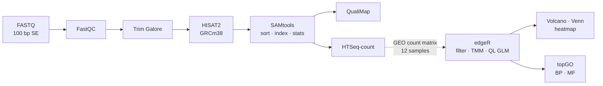
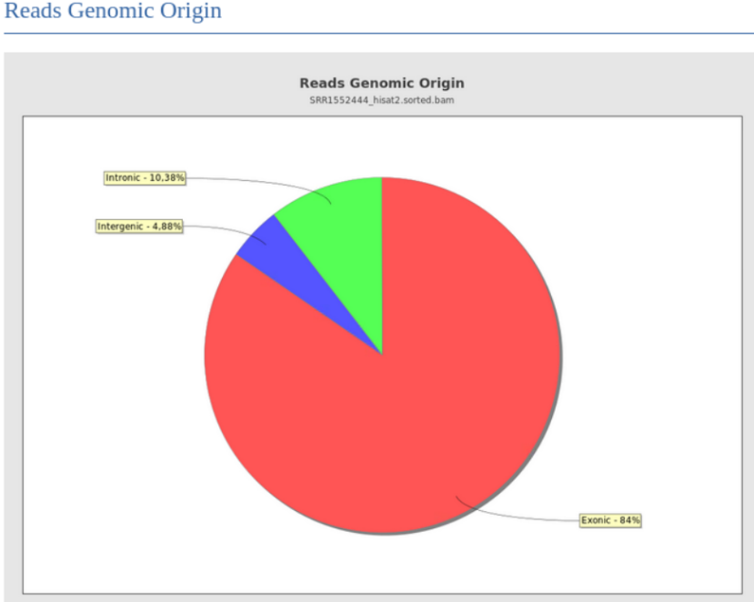
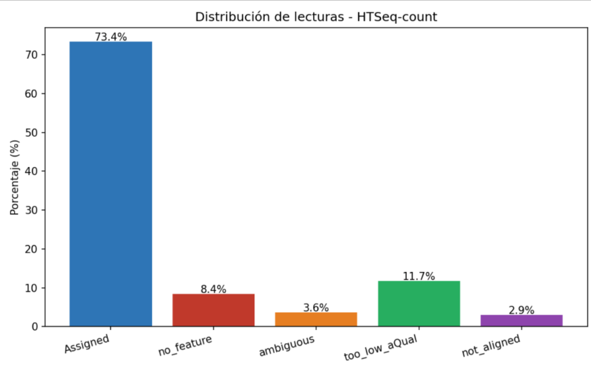
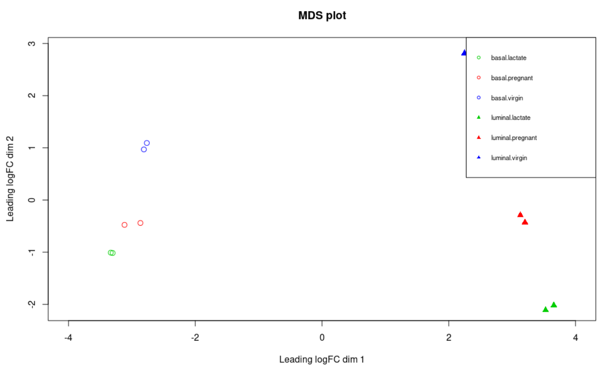
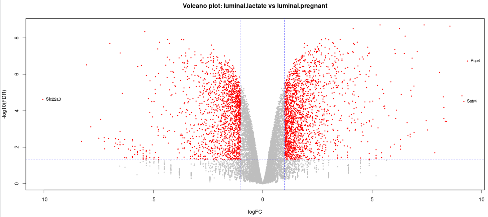
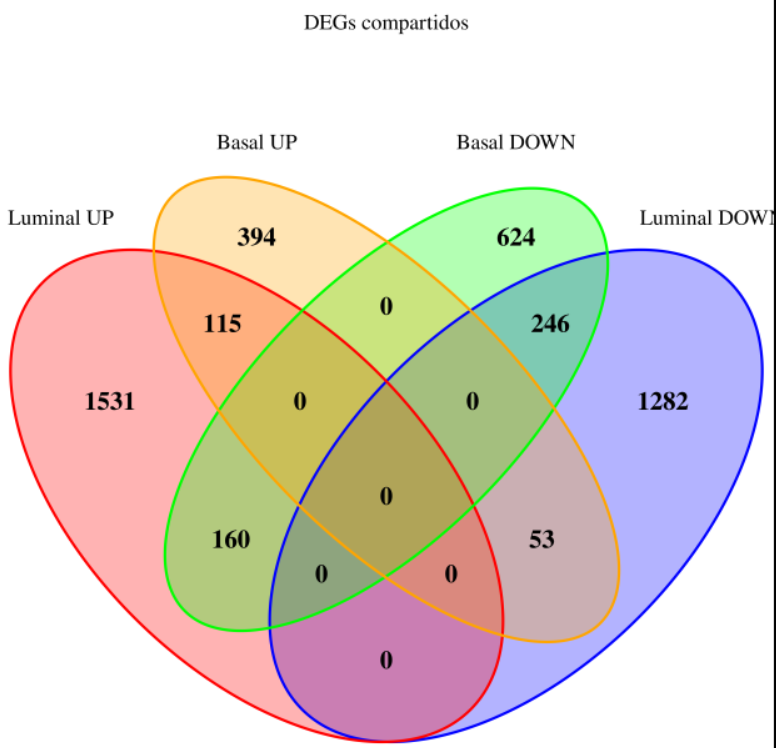
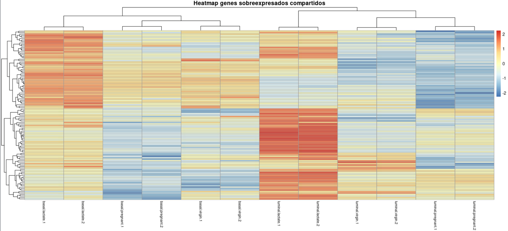

# RNA-seq of the mouse mammary gland: from raw reads to pathways

End-to-end bulk RNA-seq analysis of basal and luminal mammary epithelial cells in virgin, pregnant and lactating mice ([Fu et al., 2015, *Nature Cell Biology*](https://doi.org/10.1038/ncb3117); GEO [GSE60450](https://www.ncbi.nlm.nih.gov/geo/query/acc.cgi?acc=GSE60450)).

**Key result:** in luminal cells, the switch from pregnancy to lactation changes the expression of **3,387 genes** (FDR ≤ 0.05, |log2FC| ≥ 1). The **115 genes** induced in *both* basal and luminal cells are strongly enriched in **cholesterol and sterol biosynthesis** (p ≈ 3 × 10⁻¹³). That fits the lipid-synthesis programme needed to produce milk.

## Workflow



| Stage | Steps | Tools |
|---|---|---|
| **Upstream** (reads → counts) | `01`–`07` or `workflow/main.nf` | FastQC 0.11.9, Trim Galore 0.6 (cutadapt 3.5), HISAT2 2.2.1, SAMtools 1.18, QualiMap 2.3, HTSeq 2.0, MultiQC |
| **Downstream** (counts → DEGs → GO) | `08`–`09` | R 4.3, edgeR, limma, org.Mm.eg.db, topGO, pheatmap, ggplot2, VennDiagram |

The upstream steps were run in full on sample **SRR1552444** (luminal, virgin; 27.9 M reads). The downstream analysis uses the authors' published gene-wise count matrix for all 12 samples (6 groups × 2 replicates).

## Repository structure

```
├── config/
│   ├── config.sh            # paths and parameters (no hard-coded paths in scripts)
│   └── samples.tsv          # 12 samples: SRR accession, GEO name, cell type, status
├── envs/                    # conda environments (upstream / downstream)
├── scripts/
│   ├── 00_download_data.sh  # FASTQ (ENA), mm10 index, GENCODE M10, GEO counts
│   ├── 01_qc_raw.sh         # FastQC
│   ├── 02_trim.sh           # Trim Galore + FastQC + MultiQC
│   ├── 03_align.sh          # HISAT2 | samtools sort  → sorted, indexed BAM
│   ├── 04_alignment_stats.sh# flagstat, FLAG and MAPQ distributions
│   ├── 05_qualimap.sh       # RNA-seq alignment QC
│   ├── 06_count.sh          # HTSeq-count
│   ├── 07_plot_count_summary.py
│   ├── 08_differential_expression.R
│   ├── 09_go_enrichment.R
│   └── utils/               # shared helpers, GTF exploration
├── workflow/                # Nextflow (DSL2) version of steps 1–7
├── data/README.md           # where the data comes from (no data is committed)
└── results/figures/
```

## How to run

```bash
git clone https://github.com/Dvid99/mouse-mammary-rnaseq.git
cd mouse-mammary-rnaseq

conda env create -f envs/upstream.yml
conda env create -f envs/downstream.yml

# Data (use SAMPLE_FILTER=SRR1552444 to download a single sample)
bash scripts/00_download_data.sh

# Upstream — shell scripts, step by step
conda activate rnaseq-upstream
for s in scripts/0[1-6]_*.sh; do bash "$s"; done

# ...or as one Nextflow command (parallel per sample)
nextflow run workflow/main.nf -profile conda

# Downstream
conda activate rnaseq-downstream
Rscript scripts/08_differential_expression.R
Rscript scripts/09_go_enrichment.R
```

The full workflow (Nextflow test profile + both R scripts) has been run end to end on Google Colab. Quick check with 1,000-read test files (plus the reference and count matrix): `bash scripts/00_download_data.sh --test`, then `nextflow run workflow/main.nf -profile conda,test`.

## Results

### Upstream QC (SRR1552444)

| Metric | Value |
|---|---|
| Raw reads | 27,919,481 |
| Reads after trimming | 27,906,762 (TruSeq adapter `AGATCGGAAGAGC` found in 34.6% of reads) |
| HISAT2 overall alignment (`-k 1`) | 97.07% |
| Unique alignments (MAPQ 60) | 85.4% |
| Exonic / intronic / intergenic reads | 84% / 10.4% / 4.9% |
| Reads assigned to genes (HTSeq-count) | 73.4% |

Most reads are exonic, as expected for poly-A selected libraries (TruSeq RNA v2). Coverage is uniform across the gene body and falls off at the 3′ end. The 11.7% of reads classed as `too_low_aQual` match the multi-mapped reads (MAPQ 1) that HTSeq-count discards. `-k 1` was preferred over `-k 5`: the overall alignment rate is nearly the same (97.07% vs 97.14%), but `-k 5` makes a larger SAM (+1.6 GB) and secondary alignments that HTSeq-count cannot assign.

<p align="center">
  
  
</p>

### Differential expression (edgeR, quasi-likelihood F-test)

- 27,179 genes → **15,969** kept after `filterByExpr` (58.75%).
- TMM factors < 1 for the lactating luminal samples (≈ 0.53). Their libraries are dominated by casein transcripts (*Csn1s2a* reaches ~2.9 M counts).
- On the MDS plot, **cell type** separates samples on dimension 1 and **physiological status** on dimension 2. Replicates cluster tightly.
- Common dispersion = 0.0134 (BCV ≈ 0.12).

| Contrast | DEGs | Up | Down |
|---|---|---|---|
| Luminal: lactation vs pregnancy | 3,387 | 1,806 | 1,581 |
| Basal: lactation vs pregnancy | 1,592 | 562 | 1,030 |

<p align="center">
  
  
</p>

The largest changes in luminal cells are *Pcp4* (log2FC +9.4) and *Sstr4* (+9.2), both induced, and *Slc22a3* (−10.1), repressed. Most DEGs are specific to one cell type. **115 genes are induced and 246 repressed in both** basal and luminal cells, and these form a shared lactation programme.

<p align="center">
  
  
</p>

### Functional enrichment (topGO, classic Fisher test)

| GO Biological Process | Genes | p-value |
|---|---|---|
| cholesterol biosynthetic process | 10 / 41 | 3.2 × 10⁻¹³ |
| sterol biosynthetic process | 10 / 47 | 1.4 × 10⁻¹² |
| steroid biosynthetic process | 12 / 116 | 5.8 × 10⁻¹¹ |
| isoprenoid biosynthetic process | 6 / 22 | 1.0 × 10⁻⁸ |

For molecular function, the top terms are chloride channel activity (calcium-activated and volume-sensitive) and aldehyde dehydrogenase (NADP⁺) activity.

GO results depend on the annotation release. The table shows the original analysis; re-running with `org.Mm.eg.db` 3.18 gives the same top terms with slightly different counts (cholesterol biosynthetic process: 11/45 genes, p = 1.2 × 10⁻¹⁴). All edgeR results above are identical between the two runs.

### Biological interpretation

The genes switched on at lactation in both epithelial lineages are mainly enzymes of the mevalonate–cholesterol pathway. During lactation the alveolar epithelium becomes a lipid-synthesising factory: milk-fat globules are wrapped in a cholesterol-rich membrane taken from the apical plasma membrane, so sterol synthesis must rise to keep pace ([Rudolph et al., 2007](https://doi.org/10.1152/physiolgenomics.00020.2006)). The chloride-channel terms point to the ion transport that drives fluid secretion into the alveolar lumen. The luminal response is about twice as large (3,387 vs 1,592 DEGs), and casein (*Csn1s2a*) becomes the most abundant transcript in lactating luminal cells. This fits the luminal alveolar cells being the main secretory population, which is the population Fu et al. show depends on EGF-induced Mcl-1 to survive the switch to lactation.

## Notes

- `03_align.sh` pipes HISAT2 straight into `samtools sort`, so the ~8 GB intermediate SAM is never written.
- The upstream counts use GENCODE gene IDs. The downstream matrix from GEO uses Entrez IDs (featureCounts), so symbols are mapped with `org.Mm.eg.db` (about 1,300 IDs have no symbol; the exact number depends on the annotation version).
- Each R script writes `sessionInfo.txt` next to its results so package versions are recorded.

## References

- Fu NY *et al.* (2015). EGF-mediated induction of Mcl-1 at the switch to lactation is essential for alveolar cell survival. *Nat Cell Biol* 17:365–375. [doi:10.1038/ncb3117](https://doi.org/10.1038/ncb3117)
- Kim D *et al.* (2019). Graph-based genome alignment and genotyping with HISAT2 and HISAT-genotype. *Nat Biotechnol* 37:907–915.
- Anders S, Pyl PT, Huber W (2015). HTSeq — a Python framework to work with high-throughput sequencing data. *Bioinformatics* 31:166–169.
- Robinson MD, Oshlack A (2010). A scaling normalization method for differential expression analysis of RNA-seq data. *Genome Biol* 11:R25.
- Chen Y, Lun ATL, Smyth GK (2016). From reads to genes to pathways: differential expression analysis of RNA-Seq experiments using Rsubread and the edgeR quasi-likelihood pipeline. *F1000Research* 5:1438.
- Alexa A, Rahnenführer J. topGO: Enrichment Analysis for Gene Ontology. Bioconductor.

## Author

**David Gómez Collado** — MSc Bioinformatics (VIU), BSc Biotechnology (Universidad de Extremadura).
